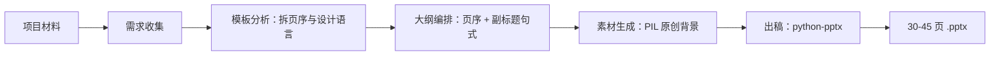

<div align="center">

# Competition PPT Skill

**中国国际大学生创新大赛 · 路演 PPT 生成方法论**

[](https://github.com/liu-1101B/competition-ppt-skill/stargazers)
[](LICENSE)
[](https://www.python.org/)

把"国赛金奖 PPT 长什么样"这件事，拆成一条能照着走完的流水线。

[快速开始](#快速开始) · [产出](#产出长什么样) · [方法论](#方法论) · [评分映射](#评分维度对应的页面权重) · [FAQ](#faq)

</div>

---

## 这是什么

不是模板库，是一套**方法论 + 生成脚本**。

网上大多数"竞赛 PPT 模板"是把同一批素材换来换去，撞车比做砸更致命。这套东西反着来：不复制素材，只拆解结构——方法论文档介绍了如何参考路演模板分析页序、Section 标签体系、副标题句式、配色与排版节奏，再用 `python-pptx` + `PIL` 生成原创背景和版式。**当前仓库随附的 `examples/build-ppt.py` 仍是“助你好梦”项目的 20 页示例脚本，不是能够自动生成任意项目 30–45 页幻灯片的通用引擎。**

一份 `SKILL.md`（方法论）+ 两个脚本（生图 / 出稿），交给具备文件读写能力的 Agent 执行。

## 为什么需要它

- **评委给每页的时间大约 7 秒。** 页序错了，技术再硬也讲不出来。国赛的结构是有强约定的一组页面，不是自由创作。
- **会做的人说不清怎么做。** 这套方法论把"经验"变成"规则"：每一页该放什么、放几页、副标题怎么写、数据从哪来。
- **模板素材有版权，且风格未必匹配。** 背景、分割线、图标全部由 PIL 程序化生成，不引入第三方素材。

## 效果

一份 35 页左右的成稿，大致长这样：

- **封面**：深蓝渐变 + 金色光晕，项目名 + 一句话定位 + 赛道 + 负责人
- **技术参数页**：4–5 列对比表，本项目列高亮，每个指标都带量化和来源
- **应用案例页**：企业资质、合作时间、我方职责、量化成效，四段式固定结构

<!--
  有截图后：把图片放进 docs/，去掉下面两行的注释，再删掉上面这三行文字描述。
  
  
-->

## 快速开始

需要 Python 3.9+。安装脚本依赖：

```bash
python -m pip install python-pptx pillow
```

生成配套背景（默认输出到 `examples/ppt-assets/`）：

```bash
python examples/generate-assets.py
```

生成随仓库提供的“助你好梦”20 页示例稿（默认输出到 `examples/output/助你好梦_国赛路演.pptx`）：

```bash
python examples/build-ppt.py
```

路径可通过参数显式指定，且不依赖作者的沙箱目录：

```bash
python examples/generate-assets.py --output-dir ./work/backgrounds
python examples/build-ppt.py --image-dir ./work/project-images --background-dir ./work/backgrounds --output ./work/demo.pptx
```

若没有提供项目图片或背景，脚本会跳过对应图片，仍可生成布局示例；因此最终观感取决于资产是否齐全。

1. 把 `SKILL.md` 放进 Agent 的 skills 目录（Claude Cowork / 其他兼容 skills 规范的环境）。
2. 准备好项目材料：策划书、路演稿、产品图、数据表。有参考模板就一起给。
3. 对 Agent 说：

```
用 competition-ppt 帮我把这个项目做成国赛路演 PPT，
配色走深蓝+金，页数 35 页左右。
```

前提：你的 Agent 需要能读写本地文件、执行 Python、查看图片。

## 产出长什么样

默认按国赛评分维度分配页数：

| 板块 | 覆盖页面 | 建议页数 | 占比 |
|---|---|---|---|
| 开篇论证 | 封面、政策背景、行业现状、痛点分析 | 5–7 | ~15% |
| 项目创新 | 项目概述、研发历程、核心技术（每项 1–2 页）、技术参数、技术壁垒 | 12–16 | ~35% |
| 产业价值 | 应用案例、应用场景、竞品分析、商业模式、盈利预估、未来规划 | 11–14 | ~30% |
| 团队协作 | 个人成长三步曲、团队介绍、学科引领、荣誉、媒体、致谢 | 7–9 | ~20% |

单页固定版式：左上角 Section 标签、`——` 开头的论点式副标题、右下角页码。这套版式是从模板里反推出来的，不是自创。

## 方法论



几个刻意的取舍：

- **模板只学不抄。** 用 `python-pptx` 提取每页的 shape 坐标、背景图、配色，总结设计语言，然后重新做一套。
- **背景程序化生成。** 五张全出血背景（封面 / 内容 / 时间线 / 深色强调 / 致谢）+ 金色分割线，全部 PIL 现场画。
- **文案有模板。** 每一类页面都配了句式，比如痛点是"2–4 字命名 + 一句话 + 量化数据 + 来源"，竞品是 4–6 个维度的对比表且本项目列高亮。

## 评分维度对应的页面权重

| 评分维度 | 分值 | 对应页面 |
|---|---|---|
| 个人成长 | 30 | 成长三步曲、团队介绍、学科引领、带动教育 |
| 项目创新 | 30 | 核心技术、技术参数、技术壁垒、衍生技术 |
| 产业价值 | 25 | 商业模式、应用案例、应用场景、盈利预估、竞品分析 |
| 团队协作 | 15 | 团队介绍、领导关怀、行业认可、媒体报道 |

这条映射是这套方法论的骨架：先按分值排页数，再往里填内容，而不是先做 20 页再想怎么凑够 43 页。

## 目录结构

```
competition-ppt-skill/
├── SKILL.md                  # 方法论全文：8 个步骤 + 页面文案模板 + 常见错误
├── examples/
│   ├── build-ppt.py          # 出稿脚本（版式 helper + 页面布局模式）
│   └── generate-assets.py    # 背景与装饰素材生成（PIL）
└── README.md
```

## FAQ

**需要联网或调 API 吗？**
不需要。纯本地 `python-pptx` + `PIL`。

**拿到别的比赛能用吗？**
能。改 SKILL.md 第三步的大纲表和第八步的评分映射即可，生成脚本不用动。

**字体报错 / 显示不对？**
默认用等线（Windows 自带）。macOS 换成苹方，改 SKILL.md 里的 `font_name`。

**生成的 PPT 里图片会重复吗？**
背景由 PIL 按参数生成，每次不一样；项目图需要你自己提供，脚本只负责摆版式。

**为什么是 30–45 页？**
20 页以下论证不充分，是这个赛道的共识。每个核心技术点独立成页，是国赛模板的共同做法。

## 授权

[MIT](LICENSE)。拿去用、拿去改，改完不用告诉我。
